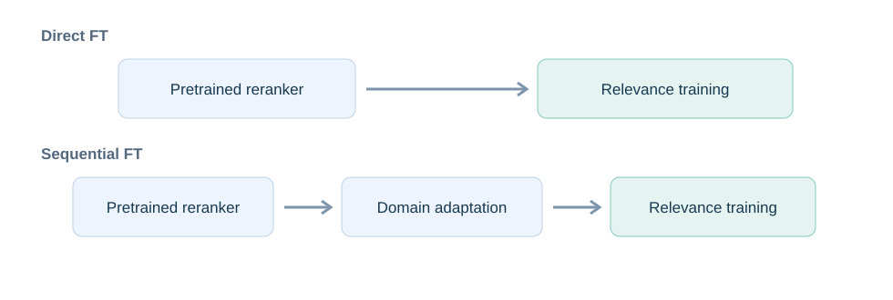
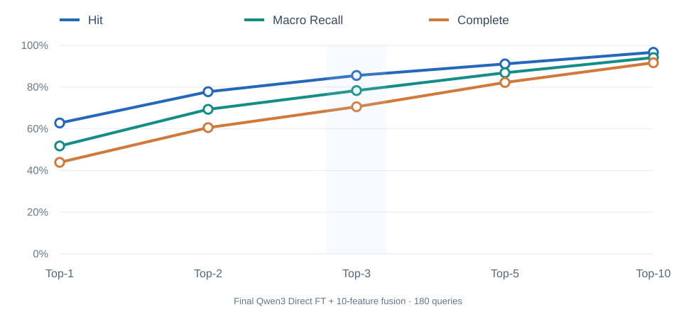
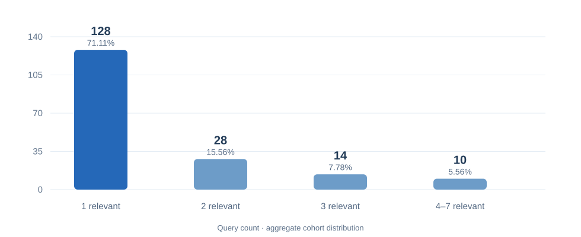
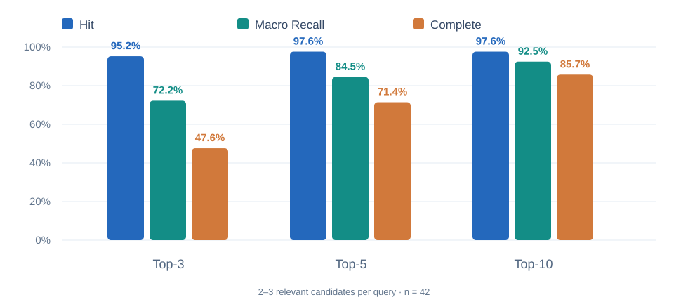

  
Independent research · Empirical retrospective · v0.5

  <h2>Finding a relevant item is not the same as recovering the relevant set.</h2>
  
Controlled observations from a proprietary multi-label reranking study. Numerical findings below describe the specified experimental configuration, not an independently reproducible public benchmark.

  

180

Queries in the later evaluation

  

100

Candidate items per query

  

85.56%

Overall Hit@3

  

47.62%

Complete@3 on 2–3 label queries

## Abstract

Compact language models offer several approaches to relevance reranking, ranging from specialized encoder-based models to foundation-model-based rerankers and architectures that jointly examine multiple candidates. Their effectiveness in domain-specific applications depends not only on pretrained model capability, but also on adaptation strategy, training objective, and evaluation methodology.

This report examines these factors through a survey of modern reranking approaches and a series of experiments on a proprietary multi-label relevance-ranking task. The investigation focuses on direct task fine-tuning, sequential domain-to-task adaptation, parameter-efficient training, and ranking behavior at different output depths.

Task-specific adaptation substantially improved the original pretrained rerankers, while additional intermediate domain training did not consistently produce better results. Detailed evaluation also revealed an important distinction between identifying at least one relevant candidate and retrieving all relevant candidates within a shallow ranking cutoff. This difference becomes particularly significant when most evaluation queries contain only one relevant item.

The findings provide a practical perspective on adapting compact rerankers, understanding multi-label ranking behavior, and selecting evaluation metrics that reflect the intended ranking objective.

**Keywords:** Reranking · Small Language Models · Domain Adaptation · Multi-Stage Fine-Tuning · Learning to Rank · Multi-Label Relevance · Ranking Completeness

---

## 1. Introduction

Modern reranking models extend beyond conventional discriminative encoders. Foundation-model-based rerankers, candidate-aware architectures, and structured decision models offer different approaches to estimating query–candidate relevance.

These approaches vary in representation learning, training objectives, scoring mechanisms, and computational cost.

For specialized applications, general language understanding does not necessarily imply effective relevance ranking. A pretrained model may understand a technical requirement without correctly identifying the candidates most relevant to it.

Conversely, a compact model can learn useful domain-specific relevance distinctions through targeted supervision.

The problem becomes more demanding when a query contains multiple relevant candidates. Correctly identifying one relevant candidate does not imply that all relevant candidates will appear near the beginning of the ranked list.

This report investigates two principal questions:

**How effectively can compact rerankers adapt to a specialized relevance task through supervised fine-tuning?**

**How should ranking effectiveness be interpreted when queries have multiple relevant candidates and only a limited number of results can be processed?**

The report focuses on model architectures, adaptation strategies, and empirical ranking behavior. Upstream candidate generation and downstream retrieval orchestration are considered outside its main scope.

---

## 2. Landscape of Compact Reranking Models

### 2.1. Specialized Relevance Models

Traditional neural rerankers process query–candidate pairs jointly and produce relevance scores.

A general formulation is:

`s(q, d) = fθ(q, d)`

where `q` is the query, `d` is the candidate, and `s` represents estimated relevance.

Bidirectional encoders provide a straightforward architecture for this task.

**BGE-reranker-v2-m3** represents a conventional specialized relevance-scoring model. Its primary function is to evaluate query–document pairs and produce scalar ranking scores [1].

**Laya Multilingual** follows a related but different direction. It combines an encoder-based architecture with typed decision-making capabilities. Its compact representation and non-autoregressive inference make it relevant to domain-specific classification and relevance judgments [2].

Laya was investigated during the initial experiments to examine whether a specialized decision model could learn technical relevance effectively.

### 2.2. Foundation-Model-Based Rerankers

Foundation-based rerankers reuse representations learned by pretrained language models.

**Qwen3-Reranker** extends Qwen3 foundation models with relevance-ranking capabilities. The released family includes 0.6B, 4B, and 8B variants [3].

The 0.6B checkpoint was central to this study.

Its scoring mechanism uses the difference between affirmative and negative output-token logits:

`score(q, d) = logit(yes) − logit(no)`

This enables relevance scoring without generating a long natural-language response.

**Prism-Reranker**, based on Qwen3.5, provides another approach to foundation-model reranking [4].

Beyond scalar relevance scores, the published Prism models can produce contribution and evidence-oriented outputs.

The experiments considered here focused on relevance scoring rather than evidence generation.

A central question was whether differences in pretrained architecture and specialization would affect the benefits obtained through domain-specific fine-tuning.

### 2.3. Candidate-Aware Rerankers

Conventional rerankers often score candidates independently.

Candidate-aware models instead use information about multiple candidates during relevance estimation.

**Jina-reranker-v3.5** uses listwise candidate interaction with a hybrid-attention architecture and self-distillation [5].

**E2Rank** combines embedding-based efficiency with candidate-aware ranking. It constructs a query representation incorporating candidate-list information and uses embedding similarity for ranking [6].

These approaches are relevant to tasks in which candidate relationships may influence ranking decisions.

However, listwise inference architecture and listwise training objectives should not be considered interchangeable.

Both models were investigated as architectural alternatives. Their local experimental coverage was more limited than that of Qwen3 and Prism.

### 2.4. Probabilistic Decision Models

Jev and Reinforcement Learning for Calibrated Decisions (RLCD) represent a related research direction [7].

Unlike a conventional reranker, a calibrated decision model emphasizes structured probabilistic predictions.

Ranking and calibration optimize different properties.

A model may order relevant candidates correctly while producing poorly calibrated probabilities.

Conversely, calibrated probabilities do not guarantee superior Top-K ranking.

Jev was considered as a conceptual comparison rather than a directly evaluated reranker in the final experiments.

#### Table 1. Overview of model families

| Model family | Approximate size | Principal approach | Research role |
|---|---:|---|---|
| BGE-reranker-v2-m3 | 0.6B | Specialized relevance scoring | Exploratory |
| Laya Multilingual | 0.322B | Encoder-based decisions | Early experiments |
| Qwen3-Reranker | 0.6B / 4B | Foundation-based reranking | Main experiments |
| Prism-Qwen3.5 | 0.8B | Foundation-based ranking and evidence | Main experiments |
| Jina-reranker-v3.5 | 0.6B | Listwise candidate interaction | Architectural exploration |
| E2Rank | 0.6B | Candidate-aware embedding ranking | Architectural exploration |
| Jev | Not publicly specified | Calibrated decisions | Conceptual comparison |

---

## 3. Fine-Tuning Strategies

### 3.1. Direct Task Fine-Tuning

Direct Task Fine-Tuning adapts a pretrained reranker immediately to the target relevance task.

**Pretrained model → Supervised relevance training**

The training examples consist of queries, candidates, and relevance labels.

The objective is to improve the model's ability to distinguish relevant from irrelevant candidates.

This approach requires one additional training stage and directly optimizes the intended task.

Its primary advantage is simplicity.

### 3.2. Sequential Domain-to-Task Fine-Tuning

Sequential Fine-Tuning introduces intermediate domain training before relevance adaptation.

**Pretrained model → Domain adaptation → Supervised relevance training**

The intermediate stage uses domain-specific technical relationships to adjust the model's representations.

The final stage optimizes query–candidate relevance.

The intended benefit is improved domain understanding before learning the ranking task.

However, intermediate domain learning and relevance ranking are different objectives. Better domain representations do not automatically produce better ranking at every cutoff.

#### Table 2. Fine-tuning strategies

| Aspect | Direct Fine-Tuning | Sequential Fine-Tuning |
|---|---|---|
| Intermediate domain training | No | Yes |
| Task-specific relevance training | Yes | Yes |
| Additional training stages | 1 | 2 |
| Intended benefit | Direct task alignment | Domain representation transfer |
| Primary trade-off | Depends on relevance supervision | Greater training complexity |
| Internal experiment identifier | L2-only | L1→L2 |

The descriptive terminology is used throughout this report. Original identifiers are included only for traceability.

Figure 1. Two fine-tuning paths examined in the research; intermediate domain adaptation is the additional stage in Sequential Fine-Tuning.

### 3.3. Training Objectives

The experiments investigated relevance learning primarily through supervised binary objectives.

**Binary Cross-Entropy (BCE)** teaches the model to distinguish relevant and irrelevant query–candidate pairs.

**Grouped BCE** organizes positive and negative pairs around each query while retaining binary relevance supervision.

Although examples are grouped, this does not make the objective equivalent to listwise ranking optimization.

**Pairwise ranking losses** directly optimize differences between positive and negative candidate scores.

**Listwise objectives** optimize ranking behavior across multiple candidates and may better align with ranking-level metrics, depending on their formulation.

The available experiments did not establish a controlled comparison proving that any of these objectives is superior for the final task.

### 3.4. Parameter-Efficient Training

The experiments were conducted using consumer hardware with a 16 GB NVIDIA GPU.

Parameter-efficient adaptation was therefore important.

LoRA updates pretrained models through trainable low-rank matrices while keeping the original weights frozen [8].

The later controlled fine-tuning experiments used BF16 computation, LoRA rank 16, alpha 32, and two epochs of relevance training.

Training also required attention to microbatch sizing, gradient accumulation, memory usage, checkpoint recovery, and reproducibility.

These constraints influenced experimental execution but were not treated as evidence of model-ranking superiority.

---

## 4. Experimental Design

### 4.1. Private Multi-Label Relevance Task

The empirical task involves ranking technical components against natural-language requirements.

Each query may contain one or more relevant candidates.

The underlying records, technical descriptions, and repository identities are proprietary.

Only aggregate experimental measurements are included.

The ranking models received a bounded candidate set from an upstream retrieval stage.

Therefore, the reported results measure ranking quality conditional on candidate availability.

### 4.2. Experimental Progression

The investigation developed through several stages.

**Early model adaptation:** Laya was investigated using a development cohort of 393 queries and 507 relevant labels.

**Foundation-model adaptation:** Qwen3-Reranker-0.6B was evaluated in its original state, after Direct Fine-Tuning, and after Sequential Fine-Tuning.

**Architecture comparison:** Prism-Qwen3.5-Reranker-0.8B was introduced to compare another pretrained backbone and adaptation strategy.

**Later evaluation:** A separate batch of 180 queries and 274 relevant identities was used to evaluate final trained configurations and conduct additional analyses.

Historical development experiments used five-fold out-of-fold predictions to reduce direct overlap between training and evaluation examples.

However, the experiments were iterative, and the later evaluation batch was not completely untouched during research.

Consequently, the results should be interpreted as empirical observations from the studied setting.

### 4.3. Final Reporting Configuration

For the detailed results in this report, the selected configuration is:

**Qwen3-Reranker-0.6B — Direct Task Fine-Tuning — 10-feature learned ranking fusion, without E5-dependent features.**

The fusion combines the model's relevance score with ten-feature ranking evidence using coefficients learned from historical training data.

The model receives the same bounded candidate pool used in the corresponding evaluation.

The detailed cardinality results below apply only to this configuration.

The ten-feature fusion is not equivalent to standalone neural ranking. Therefore, these results describe the complete scoring configuration, not the raw Qwen checkpoint alone.

Results from other scoring configurations are not mixed into the final evaluation tables.

---

## 5. Evaluation Methodology

### 5.1. Metrics for Multi-Label Ranking

Let `G(q)` denote the relevant candidates for query `q`, and `TopK(q)` the first K ranked candidates.

Three metrics are central.

**Hit@K** measures whether at least one relevant candidate appears within Top-K.

`Hit@K(q) = 1 if G(q) ∩ TopK(q) is nonempty; otherwise 0`

**Recall@K** measures the proportion of relevant candidates recovered.

`Recall@K(q) = |G(q) ∩ TopK(q)| / |G(q)|`

Macro Recall averages this proportion across queries, giving each query equal weight.

**Complete@K** measures whether all relevant candidates appear within Top-K.

`Complete@K(q) = 1 if G(q) ⊆ TopK(q); otherwise 0`

These metrics answer different questions.

Hit measures whether the system finds an initial relevant candidate.

Recall measures how much of each query's relevant set is recovered.

Complete measures whether the entire known relevant set has been recovered.

MRR and nDCG provide complementary information about ranking positions, but neither directly replaces the interpretation of multi-label completeness.

### Cardinality-adjusted R-Precision

A further metric is useful when comparing queries containing different numbers of relevant candidates.

Let `N(q) = |G(q)|`.

**R-Precision**, a conventional information-retrieval metric, measures Precision at a cutoff equal to the number of relevant candidates.

For binary relevance:

`R-Precision(q) = Precision@N(q) = Recall@N(q)`

It answers a different question from fixed-cutoff Recall:

*If a query has N relevant candidates and the ranking provides exactly N positions, what fraction of the relevant set is recovered?*

This allows evaluation at a cutoff aligned with each query's relevance cardinality rather than applying the same fixed K to every query.

However, R-Precision does not measure full-set recovery. Two systems may have similar R-Precision while differing considerably in the probability of ranking every relevant candidate within the first N positions.

Therefore, R-Precision is reported alongside Complete@N.

### 5.2. Metric Selection by Ranking Depth

#### Table 3. Recommended evaluation perspectives

| Cutoff | Primary interpretation | Recommended metrics |
|---|---|---|
| Top-1 | Correctness of first recommendation | Hit@1 |
| Top-2 | Early concentration of relevant items | Macro Recall@2, Hit@2 |
| Top-3 | Quality of a small actionable shortlist | Macro Recall@3, Hit@3, Complete@3 |
| Top-5 | Improvement in relevance coverage and completeness | Macro Recall@5, Complete@5 |
| Top-10 | Deeper relevance recovery | Macro Recall@10, Complete@10, nDCG@10 |
| Top-N | Cardinality-aligned ranking effectiveness | R-Precision, Complete@N |

Complete@K requires special care.

If a query contains more than K relevant candidates, it is mathematically impossible to retrieve all of them within the first K positions.

Therefore, overall completeness should be interpreted alongside the number of queries eligible for full recovery.

The Top-N evaluation provides an additional perspective because each query is evaluated with exactly as many result positions as relevant candidates.

A further diagnostic can examine a small number of extra ranking positions, such as Top-(N+2). This is an exploratory cardinality-adjusted cutoff, not an established quality threshold.

---

## 6. Experimental Findings

### 6.1. Effect of Task-Specific Fine-Tuning

The historical Qwen experiments provide a direct comparison of pretrained and adapted model scores without auxiliary ranking fusion.

#### Table 4. Historical standalone Qwen3 results

| Configuration | Hit@1 | Complete@3 | Complete@5 | nDCG@5 |
|---|---:|---:|---:|---:|
| Original pretrained Qwen3 | 42.36% | 47.74% | 55.90% | 0.5087 |
| Direct Fine-Tuning | **54.69%** | 58.51% | 62.50% | 0.6016 |
| Sequential Fine-Tuning | 54.51% | **58.85%** | **63.72%** | **0.6082** |

*Historical five-fold OOF evaluation using a shared candidate pool. These are standalone neural-score results, not the final 10-feature configuration.*

Both adapted checkpoints substantially improved over the original pretrained model.

However, the advantage of Sequential Fine-Tuning over Direct Fine-Tuning was small.

Direct Fine-Tuning performed marginally better at Hit@1, while Sequential Fine-Tuning was slightly stronger at deeper completeness metrics.

This result did not establish that intermediate domain training was consistently necessary.

### 6.2. Final Evaluation: Overall Performance

The detailed final analysis used 180 queries, each with up to 100 candidate items.

The configuration was Qwen3 Direct Fine-Tuning with 10-feature fusion and no E5-dependent features.

#### Table 5. Overall ranking performance

| Metric | Top-1 | Top-2 | Top-3 | Top-5 | Top-10 |
|---|---:|---:|---:|---:|---:|
| Hit | 62.78% | 77.78% | 85.56% | 91.11% | 96.67% |
| Macro Recall | 51.75% | 69.33% | 78.33% | 86.87% | 94.15% |
| Complete | 43.89% | 60.56% | 70.56% | 82.22% | 91.67% |

At Top-3, the ranking identified at least one relevant candidate for 85.56% of queries.

However, it recovered every relevant candidate for only 70.56%.

This difference is important because a successful first relevant result does not imply complete multi-label ranking.

At Top-10, overall completeness increased to 91.67%, demonstrating that many relevant candidates appeared deeper in the ranking.

The practical significance depends on how many results the downstream application can afford to process.

Figure 2. Overall Hit, Macro Recall, and Complete at five ranking depths; Qwen3 Direct FT with 10-feature fusion, 180 queries.

### 6.3. Relevance-Cardinality Distribution

#### Table 6. Number of relevant candidates per query

| Relevant candidates | Queries | Share |
|---|---:|---:|
| 1 | 128 | 71.11% |
| 2 | 28 | 15.56% |
| 3 | 14 | 7.78% |
| 4 | 5 | 2.78% |
| 5 | 3 | 1.67% |
| 6 | 1 | 0.56% |
| 7 | 1 | 0.56% |
| More than 7 | 0 | 0.00% |
| **Total** | **180** | **100%** |

Single-label queries represented 71.11% of the evaluation batch.

This distribution substantially influences aggregate results.

For single-label queries, Hit, Recall, and Complete are equivalent at the query level.

For multi-label queries, the metrics describe different properties.

The existing audit supports a performance breakdown into four groups: one, two, three, and four-or-more relevant candidates.

The high-cardinality group contains only ten queries, limiting the strength of conclusions about larger relevance sets.

Figure 3. The later evaluation is heavily concentrated in single-label queries (128 of 180).

### 6.4. Hit@K by Label Cardinality

#### Table 7. At least one relevant candidate recovered

| Relevant candidates | N | Top-1 | Top-2 | Top-3 | Top-5 | Top-10 |
|---|---:|---:|---:|---:|---:|---:|
| 1 | 128 | 61.72% | 77.34% | 83.59% | 90.63% | 96.88% |
| 2 | 28 | 71.43% | 92.86% | 96.43% | 96.43% | 96.43% |
| 3 | 14 | 64.29% | 64.29% | 92.86% | 100.00% | 100.00% |
| ≥4 | 10 | 50.00% | 60.00% | 70.00% | 70.00% | 90.00% |

The model performed particularly well at identifying at least one relevant candidate for queries with two or three relevant items.

At Top-3, the combined two- and three-label subgroup achieved:

`Hit@3 = 40/42 = 95.24%`

However, multi-label queries provide several opportunities to obtain a hit.

Therefore, higher Hit values in these groups should not automatically be interpreted as stronger ranking quality.

### 6.5. Macro Recall@K by Label Cardinality

#### Table 8. Average proportion of relevant candidates recovered

| Relevant candidates | N | Top-1 | Top-2 | Top-3 | Top-5 | Top-10 |
|---|---:|---:|---:|---:|---:|---:|
| 1 | 128 | 61.72% | 77.34% | 83.59% | 90.63% | 96.88% |
| 2 | 28 | 35.71% | 64.29% | 78.57% | 91.07% | 94.64% |
| 3 | 14 | 21.43% | 38.10% | 59.52% | 71.43% | 88.10% |
| ≥4 | 10 | 11.50% | 24.67% | 36.67% | 48.67% | 66.45% |

Macro Recall provides a more demanding view than Hit.

For queries with two relevant candidates, Top-3 recovered an average of 78.57% of the relevant set.

For queries with three relevant candidates, this declined to 59.52%.

For queries with four or more relevant candidates, Top-3 recovered an average of 36.67%.

Some decline is structurally expected as the number of relevant candidates increases while K remains fixed. The maximum attainable Recall@K for a query with N relevant candidates is `min(1, K/N)`.

The results should therefore not be interpreted as a pure measure of model difficulty without considering this ceiling.

### Cardinality-aligned ranking: R-Precision

Fixed Top-K evaluation places queries with different numbers of relevant candidates under different capacity constraints.

R-Precision provides a complementary view by measuring Recall at the query's own relevance cardinality.

#### Table 9. Cardinality-aligned ranking effectiveness

| Relevant candidates (N) | Ranking cutoff | R-Precision = Recall@N | Complete@N |
|---|---|---:|---:|
| 1 | Top-1 | 61.72% | 61.72% |
| 2 | Top-2 | **64.29%** | 35.71% |
| 3 | Top-3 | 59.52% | 21.43% |
| 4–7 | Variable Top-N | Not calculated | Not calculated |

*The reported performance tables support exact R-Precision values for N = 1, 2, and 3. The grouped N ≥ 4 results cannot be converted into R-Precision without per-query predictions at each query's own N.*

A notable observation is that R-Precision remained within a relatively narrow range of approximately 60–64% for queries with one, two, or three relevant candidates.

This contrasts with the decline seen when comparing different cardinalities at a fixed Top-3 cutoff.

It suggests that part of the fixed-cutoff Recall difference reflects the increasing number of relevant items competing for the same ranking positions.

However, the apparent stability should be interpreted cautiously because the two- and three-label subgroups are much smaller than the single-label group.

More importantly, **similar R-Precision did not imply similar completeness**.

At the cardinality-matched cutoff, Complete@N declined from 61.72% for single-label queries to 35.71% for two-label queries and 21.43% for three-label queries.

This happens because R-Precision measures the average fraction recovered, whereas Complete requires every relevant item to occupy one of the available N positions.

The comparison therefore reveals a gap between partial relevance recovery and complete relevance ranking even after accounting for the number of relevant candidates.

### Additional ranking positions: N+2

An additional descriptive comparison considers providing two more ranking positions than the number of relevant candidates.

| Relevant candidates | Cutoff N+2 | Recall@N+2 | Complete@N+2 |
|---|---|---:|---:|
| 1 | Top-3 | 83.59% | 83.59% |
| 2 | Top-4 | Not measured | Not measured |
| 3 | Top-5 | 71.43% | 42.86% |
| 4–7 | Variable Top-(N+2) | Not calculated | Not calculated |

The available results do not establish a general N+2 rule.

For single-label queries, Top-3 exceeded 80% in both Recall and Complete.

For three-label queries, Top-5 remained below 80% Recall and substantially below 80% Complete.

For two-label queries, Top-4 was not included in the recorded ranking cutoffs, so the exact result cannot be inferred from Top-3 and Top-5.

Nevertheless, the comparison illustrates a useful distinction: a small surplus of ranking positions can improve coverage, but its effectiveness depends on how the model orders multiple relevant candidates.

### 6.6. Complete@K by Label Cardinality

#### Table 10. Entire relevant set recovered

| Relevant candidates | N | Top-1 | Top-2 | Top-3 | Top-5 | Top-10 |
|---|---:|---:|---:|---:|---:|---:|
| 1 | 128 | 61.72% | 77.34% | 83.59% | 90.63% | 96.88% |
| 2 | 28 | 0.00% | 35.71% | 60.71% | 85.71% | 92.86% |
| 3 | 14 | 0.00% | 0.00% | 21.43% | 42.86% | 71.43% |
| ≥4 | 10 | 0.00% | 0.00% | 0.00% | 20.00% | 50.00% |

This table illustrates the difference between finding one relevant candidate and recovering the entire relevant set.

For three-label queries, Hit@3 reached 92.86%, but Complete@3 was only 21.43%.

Among these fourteen queries:

- Three recovered all three relevant candidates.
- Six recovered two.
- Four recovered one.
- One recovered none.

All 42 relevant identities for this subgroup were already present within the 100-candidate pool.

Therefore, the missing Top-3 results were attributable to their positions in the ranking rather than missing candidates.

This identifies a remaining ranking limitation without requiring an assumption about its underlying cause.

### 6.7. Overall vs Eligible Completeness

Complete@K is mathematically impossible when a query contains more than K relevant candidates.

It is therefore useful to report both overall completeness and completeness among structurally eligible queries.

#### Table 11. Complete@K interpretation

| Cutoff | Eligible queries | Complete queries | Overall Complete | Eligible Complete |
|---|---:|---:|---:|---:|
| Top-1 | 128 | 79 | 43.89% | 61.72% |
| Top-2 | 156 | 109 | 60.56% | 69.87% |
| Top-3 | 170 | 127 | 70.56% | 74.71% |
| Top-5 | 178 | 148 | 82.22% | 83.15% |
| Top-10 | 180 | 165 | 91.67% | 91.67% |

At Top-3, 170 of the 180 queries contain no more than three relevant candidates.

Of these, 127 were fully recovered:

`Eligible Complete@3 = 127/170 = 74.71%`

The corresponding overall completeness was:

`Overall Complete@3 = 127/180 = 70.56%`

Both measures are valid, but they answer different questions.

The eligible measure should not replace the overall measure because excluding structurally infeasible queries changes the evaluation population.

A duplicate-group bootstrap estimated a 95% confidence interval of approximately 68.05–81.44% for eligible Complete@3.

### 6.8. The Two- and Three-Label Subgroup

The 42 queries containing two or three relevant candidates provide a useful view of multi-label ranking beyond the dominant single-label population.

#### Table 12. Multi-label performance for queries with two or three relevant candidates

| Metric | Top-3 | Top-5 | Top-10 |
|---|---:|---:|---:|
| Hit | 95.24% | 97.62% | 97.62% |
| Macro Recall | 72.22% | 84.52% | 92.46% |
| Complete | 47.62% | 71.43% | 85.71% |

At Top-3, the reranker identified at least one relevant candidate in 40 of 42 queries.

However, only 20 queries were fully recovered.

Increasing the cutoff to Top-5 raised complete recovery to 30 queries.

At Top-10, complete recovery increased to 36 queries.

This demonstrates that a substantial portion of the missing relevance was present deeper in the ranking.

It does not establish whether a different fine-tuning objective could move those additional relevant candidates into the first three positions.

Figure 4. Hit, Macro Recall, and Complete for 42 queries with two or three relevant items. High Hit@3 coexists with substantially lower Complete@3.

---

## 7. Discussion

### 7.1. Task Adaptation Matters

The historical experiments demonstrated substantial improvement after fine-tuning Qwen3 for the target relevance task.

This suggests that general pretrained relevance capability should not be treated as a fixed limit on domain-specific ranking performance.

However, model size and backbone architecture were not independently isolated from all other training factors.

### 7.2. Sequential Training Is Not Automatically Better

Intermediate domain adaptation did not consistently outperform direct relevance training.

The historical results showed only small differences between the two strategies.

This suggests that an additional domain-training stage should be justified through measured improvements rather than adopted by default.

### 7.3. Relevance Detection and Completeness Are Different Problems

The cardinality analysis demonstrated the largest practical distinction.

The final configuration achieved 85.56% overall Hit@3, but only 70.56% overall Complete@3.

Among queries with two or three relevant candidates, Hit@3 was 95.24%, while Complete@3 was 47.62%.

Therefore, **a strong ability to identify an initial relevant candidate does not necessarily imply an equally strong ability to retrieve every relevant candidate within a small Top-K**.

This observation is particularly important when single-label queries dominate the evaluation dataset.

### 7.4. Ranking Depth and Relevance Cardinality

Fixed-cutoff evaluation and cardinality-aligned evaluation provide different perspectives.

At a fixed Top-3 cutoff, Macro Recall declined from 83.59% for one-label queries to 59.52% for three-label queries.

When evaluated at Top-N, where N equals the number of relevant candidates, R-Precision remained approximately 60–64% across groups containing one, two, and three relevant candidates.

This indicates that the apparent deterioration under fixed Top-K evaluation is partly influenced by the increasing size of the relevant set relative to the available ranking positions.

However, Complete@N continued to decline with label cardinality, from 61.72% to 21.43%.

Thus, adjusting the cutoff for the number of relevant candidates does not eliminate the challenge of recovering the entire relevance set.

Providing additional ranking positions improved results, but the observed data does not establish a universal relationship such as K = N+2.

The number of results required to achieve a particular Recall or Complete target remains dependent on model behavior and the distribution of relevance labels.

In practical applications, this creates a trade-off between ranking completeness and the cost of processing additional candidates.

### 7.5. Training Objectives Remain an Open Direction

The observed difficulty in recovering every relevant item at shallow cutoffs suggests a useful research question:

*Can a ranking objective that explicitly accounts for multiple relevant candidates improve shallow completeness without reducing first-result accuracy?*

Potential approaches include pairwise, listwise, or candidate-group-aware training.

The current experiments do not establish which approach would perform best.

### 7.6. Model Evaluation Must Remain Configuration-Specific

The detailed results in this report correspond to Qwen3 Direct Fine-Tuning with 10-feature fusion.

They should not be interpreted as the performance of the raw Qwen checkpoint.

Similarly, results obtained under another feature set or candidate policy should not be mixed into the same numerical comparison.

Maintaining this distinction is necessary for reliable interpretation.

---

## 8. Limitations and Future Work

The investigation uses a proprietary dataset, preventing independent reproduction of the exact ranking results.

The research was iterative, and the later evaluation cohort was not fully independent of development decisions.

Furthermore, not every surveyed architecture received identical fine-tuning or benchmark coverage.

The cardinality distribution introduces an additional limitation: most queries contain one relevant candidate, while only ten contain four or more. There is no empirical coverage of queries with more than seven relevant candidates.

The most useful follow-up investigations would be:

1. Compare Direct and Sequential Fine-Tuning across identical relevance-cardinality groups.
2. Analyze the rank positions of the second and third relevant candidates.
3. Compare grouped BCE against explicit pairwise or listwise ranking objectives.
4. Evaluate final checkpoints on an independent, previously unexamined query cohort.

An additional diagnostic would calculate R-Precision and Recall/Complete at cardinality-adjusted cutoffs from the stored per-query predictions, including cutoffs not included in the current aggregate tables.

These experiments would help establish whether the observed multi-label completeness gap can be reduced through changes to the training objective rather than simply increasing the ranking cutoff.

---

## 9. Conclusion

This report examined compact reranking models through a series of domain-specific experiments involving specialized decision architectures, pretrained foundation-based rerankers, and alternative fine-tuning strategies.

Task-specific adaptation substantially improved the original Qwen3 reranker.

Intermediate domain training did not establish a consistent advantage over direct fine-tuning.

The detailed final analysis showed that ranking quality depends strongly on the number of relevant candidates and the evaluation cutoff.

A high probability of finding at least one relevant item did not imply complete recovery of the relevant set.

For the evaluated 10-feature Qwen configuration, overall Hit@3 reached 85.56%, while overall Complete@3 reached 70.56%. Among queries with two or three relevant candidates, the difference was considerably larger.

Cardinality-aligned evaluation provided another useful perspective: R-Precision remained approximately 60–64% across queries with one to three relevant candidates, while Complete@N declined substantially as the number of relevant items increased.

These observations reinforce the need to evaluate compact rerankers through multiple, clearly defined metrics rather than a single overall ranking score.

**Effective domain-specific reranking depends on the interaction between pretrained representations, adaptation strategy, training objectives, relevance cardinality, and the intended Top-K cutoff.**

---

## References

[1] BAAI. *BGE-reranker-v2-m3.* https://huggingface.co/BAAI/bge-reranker-v2-m3

[2] ConvAI Innovations. *Laya Multilingual.* https://huggingface.co/convaiinnovations/laya-multilingual

[3] Zhang, Y., et al. (2025). *Qwen3 Embedding: Advancing Text Embedding and Reranking Through Foundation Models.* https://arxiv.org/abs/2506.05176

[4] Zhang, D. (2026). *Prism-Reranker: Beyond Relevance Scoring—Jointly Producing Contributions and Evidence for Agentic Retrieval.* https://arxiv.org/abs/2604.23734

[5] Nasika, C., et al. (2026). *jina-reranker-v3.5: An Efficient Listwise Reranker with Hybrid Attention and Self-Distillation.* https://arxiv.org/abs/2607.18152

[6] Liu, Q., et al. (2026). *E2Rank: Unifying Text Embedding and Listwise Reranking for Effective and Efficient Search.* Proceedings of EMNLP 2026. https://aclanthology.org/2026.emnlp-main.2171/

[7] Almeida, D. (2026). *Introducing System One Models & Jev.* TypeSafe AI. https://typesafe.ai/blog/introducing-system-one-models-and-jev

[8] Hu, E. J., et al. (2021). *LoRA: Low-Rank Adaptation of Large Language Models.* https://arxiv.org/abs/2106.09685

Working report v0.5 · 2 November 2026. Underlying query records, candidate descriptions, model checkpoints, and private source artifacts are not publicly available. Aggregate results are presented as a personal experimental retrospective, not a public reproducibility claim.
